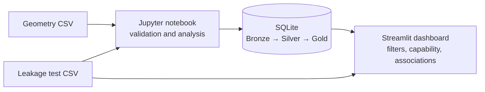

# LPS Clipping Investigation

This project investigates whether geometry and clipping performance vary by machine and cavity, and how those outcomes relate to leakage-test results. It uses a Jupyter notebook for validation, analysis and SQLite table creation, plus a Streamlit dashboard for interactive review.

## Investigation

The analysis starts with measurement-level geometry and clipping data, checks data quality, builds Bronze/Silver/Gold SQLite tables, then compares machine and cavity subgroups and tests geometry/clipping/leakage associations.

Key findings in the current training dataset:

- IM4 has the highest clipping failure rate (16.8%); cavity 7 on IM4 is the highest-risk subgroup observed (31.4%).
- Geometry is higher in the clipping FAIL group than the OK group (10.1639 mm vs 10.0206 mm).
- Clipping FAIL is associated with higher odds of leakage failure (odds ratio 24.20). This is an association, not evidence of causation.
- With illustrative training limits LSL=9.80 mm and USL=10.20 mm, overall capability is Cp=0.734 and Cpk=0.633. Replace these limits with approved engineering specifications before making a production capability claim.

The leakage results in `lps_leakage_results.csv` are synthetic and intended for training/portfolio use. Replace them with a validated test export for production work. The geometry data is provided as the project's source dataset.

## Data flow



## Reproduce

Use Python 3.10 or later. From this project directory, install dependencies:

```bash
python -m pip install -r requirements.txt
```

Run all cells in `lps_clipping_investigation.ipynb` from top to bottom to rebuild the SQLite analysis, then launch the dashboard:

```bash
streamlit run lps_clipping_investigation_dashboard.py
```

The committed `lps_geometry_clipping_analysis.db` lets the dashboard start immediately. Re-running the notebook rebuilds it from the CSV inputs.

## Project files

- `lps_clipping_investigation.ipynb` — end-to-end analysis and conclusions.
- `lps_geometry.csv` — geometry and clipping source measurements.
- `lps_leakage_results.csv` — synthetic leakage test results for training.
- `lps_geometry_clipping_analysis.db` — SQLite analysis tables used by the dashboard.
- `lps_clipping_investigation_dashboard.py` — interactive Streamlit dashboard.
- `requirements.txt` — Python dependencies.